# SmartMetro

SmartMetro, Bakı Metropoliteni üçün hazırlanmış AI əsaslı **Smart Passenger Flow System** prototipidir. Layihə 48 saatlıq intensiv inkişaf prosesində, Bakı Metropoliteni tərəfindən təşkil olunan **Metro Hackathon** çərçivəsində hazırlanıb və yarışmada **3-cü yerə** layiq görülüb.

Sistemin əsas məqsədi metro platformalarında və qatarlarda sərnişin sıxlığını real vaxtda analiz etmək, minmə prosesini sürətləndirmək və sərnişin axınını daha balanslı idarə etməkdir. Həll iki əsas hissədən ibarətdir:

- **User Mobile Application**: sərnişin üçün marşrut, canlı sıxlıq, vaqon/qapı tövsiyəsi və yönləndirmə interfeysi.
- **Real-time AI Crowd Analysis System**: kamera görüntülərindən insan sayımı, vaqon doluluğu və platforma sıxlığı analizi.

## Layihənin İdeyası

Metroda sıxlıq çox vaxt müəyyən qapıların, vaqonların və platforma sektorlarının həddindən artıq yüklənməsi ilə yaranır. SmartMetro bu problemi data əsaslı yanaşma ilə həll edir:

- Qatar daxili kameralardan istifadə edərək vaqon və qapı üzrə real-time sıxlıq analizi aparır.
- Platforma kameraları vasitəsilə sektor əsaslı crowd detection və flow optimization təmin edir.
- Mobil tətbiqdə sərnişinə ən boş vaqon, daha optimal qapı, platformadakı sıxlıq vəziyyəti və növbəti qatar haqqında canlı məlumat göstərir.
- Artırılmış reallıq konsepti ilə istifadəçiyə platformada optimal dayanma nöqtəsini oxlar və vizual yönləndirmə ilə təqdim edir.
- Gamification yanaşması ilə optimal davranış göstərən istifadəçilərə bonus qazandırmağı və həmin bonuslarla metrodan ödənişsiz istifadə imkanını hədəfləyir.

## Əsas Xüsusiyyətlər

- Real-time vaqon sıxlığı analizi
- YOLOv8 və ByteTrack ilə insan sayımı və tracking
- Vaqon doluluğuna görə `Boş`, `Orta`, `Dolu` statuslarının hesablanması
- Ən uyğun vaqonun avtomatik tövsiyə edilməsi
- Stansiya və marşrut seçimi
- Optimal və alternativ marşrut hesablanması
- Canlı qatar gəlmə vaxtı və sıxlıq xəbərdarlıqları
- Stansiya daxilində addım-addım yönləndirmə
- Login, qeydiyyat, OTP və şifrə bərpası axınları
- Profil, sevimli stansiya və bildiriş idarəetməsi
- Analytics event logging
- Postman collection və SQL dump ilə testə hazır backend
- Android üçün hazır APK artefaktı

## Ekran Görüntüləri

Mobil tətbiqin əsas axınları `presentation/screens` qovluğunda saxlanılır.

| Splash | Onboarding | Home |
| --- | --- | --- |
|  | 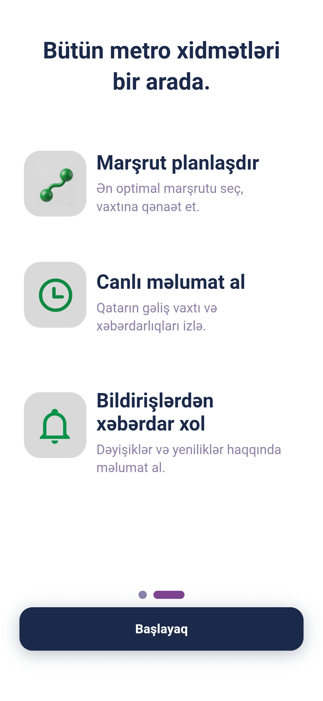 | 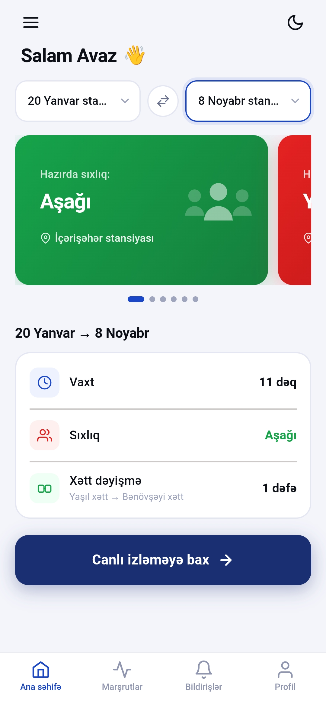 |

| Trip Planner | Live Alert | Guidance |
| --- | --- | --- |
| 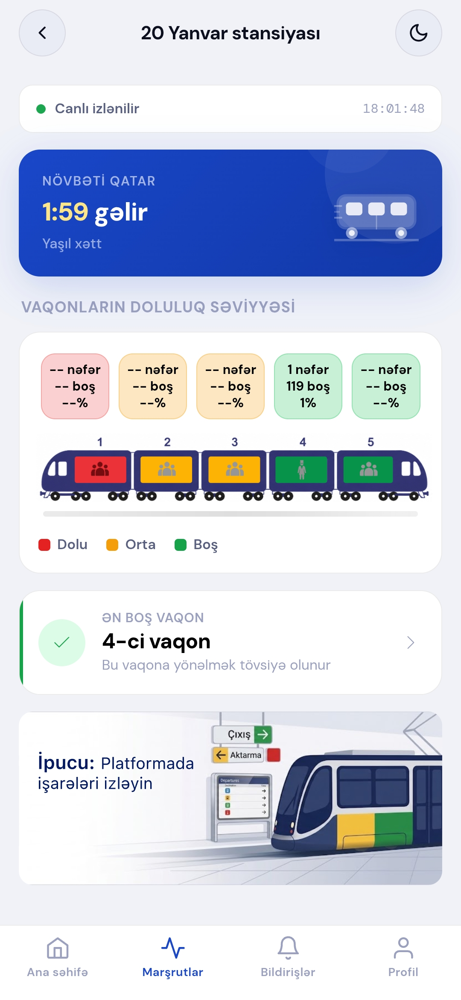 | 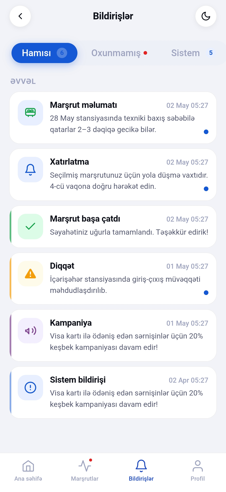 | 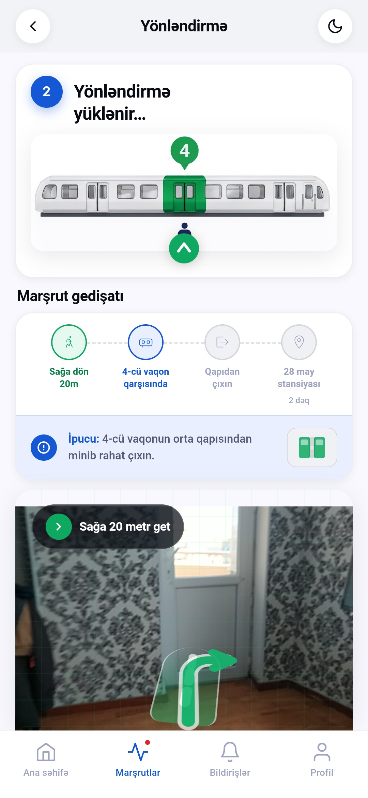 |

| Login | Register | Verification |
| --- | --- | --- |
| 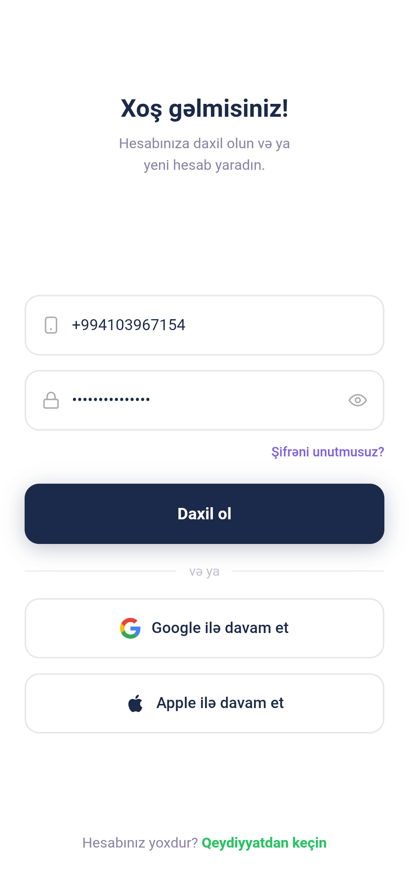 | 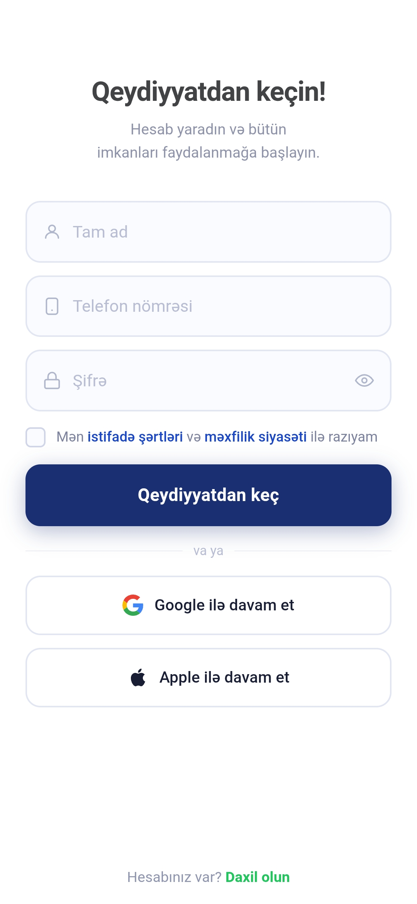 | 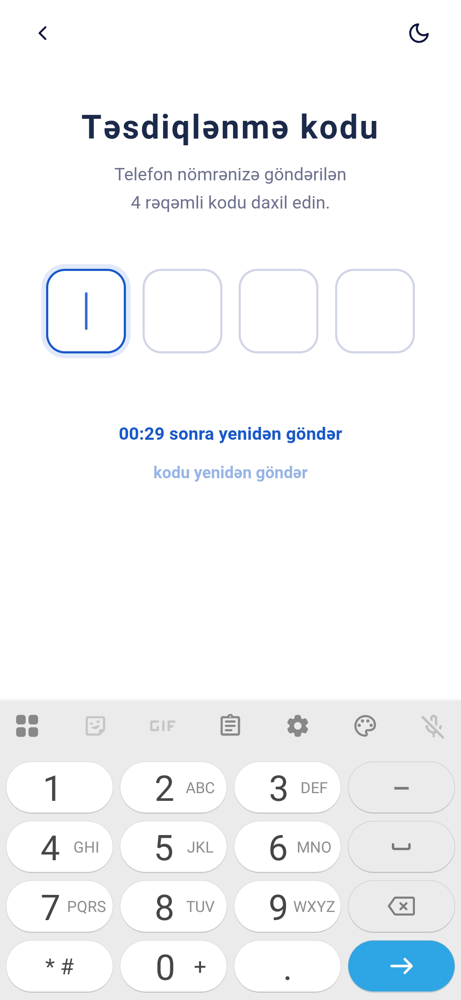 |

| Profile | Bottom Sheet | Message |
| --- | --- | --- |
| 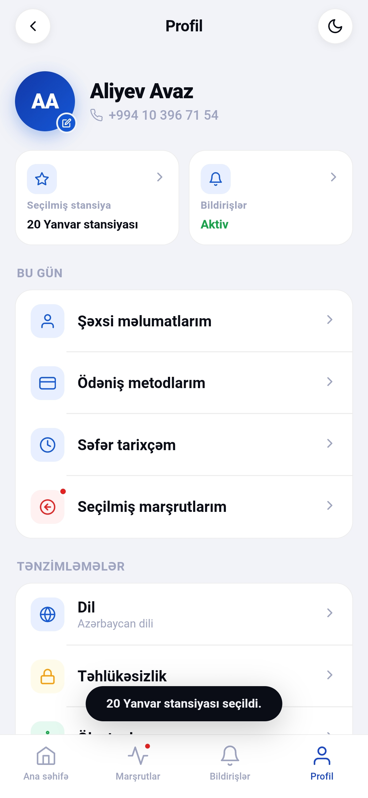 | 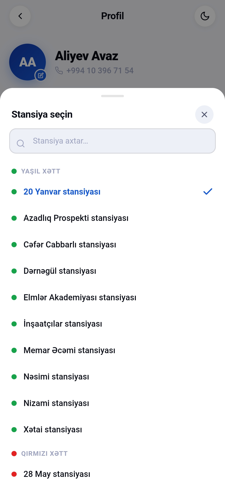 | 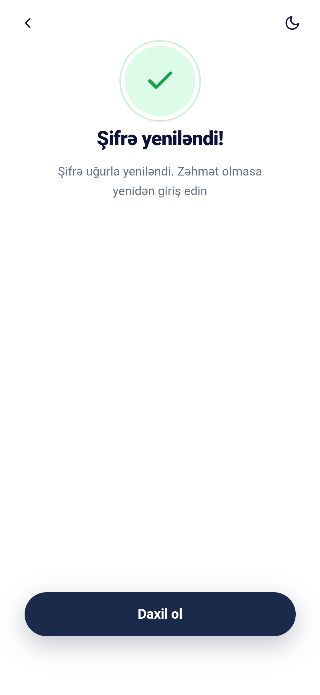 |

Poster və demo materialları:

- Poster: [`presentation/poster.png`](presentation/poster.png)
- Lokal demo video: [`presentation/videos/video.mp4`](presentation/videos/video.mp4)
- APK təqdimat videosu: [YouTube](https://youtu.be/feMl3iD60Kg)
- Tədbirdəki təqdimat videosu: [YouTube](https://youtu.be/Yi-DznlO-XU)
- Komanda ilə səmimi fotolar: [YouTube](https://youtu.be/YOBESad8Rew)
- Yusif Kərimova təşəkkür videosu: [YouTube Shorts](https://youtube.com/shorts/KxP8O72m9Vw)
- APK lokal artefaktı: [`apk/SmartMetro-v1.0.0.apk`](apk/SmartMetro-v1.0.0.apk)
- APK yükləmə linki: [SmartMetro-v1.0.0.apk](https://github.com/elcanmammadov/Smart_Metro/raw/refs/heads/main/apk/SmartMetro-v1.0.0.apk)

## Sistem Arxitekturası

```text
Camera Feed
    |
    v
AI Crowd Analysis
    - OpenCV HOG prototype
    - YOLOv8 person detection
    - ByteTrack object tracking
    |
    v
PHP REST API
    - train wagon counts
    - station live status
    - route calculation
    - guidance
    - notifications
    - analytics
    |
    v
MySQL Database
    |
    v
Cordova Android Mobile App
    - passenger guidance
    - live crowd status
    - trip planner
    - profile and notifications
```

## Texnologiyalar

| Layer | Texnologiyalar |
| --- | --- |
| Mobile | Apache Cordova, HTML, CSS, JavaScript, Axios, Cordova Camera Preview |
| Backend | PHP, MySQL, PDO, JSON REST API |
| AI | Python, OpenCV, Ultralytics YOLOv8, ByteTrack |
| Data | SQL dump, station graph, crowd status tables, analytics events |
| Delivery | Android APK, Postman collection, presentation assets |

## Repo Strukturu

```text
SmartMetro/
├── ai/                         # AI camera analysis prototypes
│   ├── app-yolo.py              # YOLOv8 + ByteTrack real-time wagon counter
│   ├── app-ocv.py               # OpenCV HOG based people counter prototype
│   └── yolov8n.pt               # YOLO nano model
├── api/                         # PHP REST API endpoints
├── db/                          # MySQL database dump
├── mobile/                      # Cordova Android mobile app
├── apk/                         # Built Android APK
├── postman/                     # API test collection
└── presentation/                # Poster, video and app screenshots
```

## Backend API

Əsas endpoint-lər:

| Endpoint | Məqsəd |
| --- | --- |
| `api/register.php` | İstifadəçi qeydiyyatı |
| `api/login.php` | Login və token yaradılması |
| `api/OTP.php` | OTP təsdiqi |
| `api/forgot_password.php` | Şifrə bərpası üçün kod göndərilməsi |
| `api/reset_password.php` | Yeni şifrə təyin edilməsi |
| `api/stations.php` | Stansiya siyahısı və axtarışı |
| `api/route.php` | Optimal və alternativ marşrut hesablanması |
| `api/home.php` | Ana səhifə üçün ümumi data |
| `api/live_tracking.php` | Stansiya üzrə canlı qatar və sıxlıq statusu |
| `api/guidance.php` | Vaqon və platforma yönləndirməsi |
| `api/train_wagon_counts.php` | AI modulundan gələn vaqon sayımlarının qəbulu |
| `api/notifications.php` | Bildirişlərin yaradılması və siyahılanması |
| `api/profile.php` | Profil, sevimlilər və tarixçə |

Postman collection:

```text
postman/SmartMetro.postman_collection.json
```

## Database

SQL dump:

```text
db/u879108216_smartmetro.sql
```

Əsas cədvəllər:

- `stations`
- `station_connections`
- `station_crowd_status`
- `station_live_status`
- `station_wagon_status`
- `train_wagon_counts`
- `station_guidance`
- `station_guidance_steps`
- `station_guidance_tips`
- `station_guidance_visuals`
- `crowd_alerts`
- `notifications`
- `analytics_events`
- `users`
- `user_tokens`
- `user_trip_sessions`

## AI Crowd Analysis

Layihədə iki AI prototipi var:

### YOLOv8 əsaslı real-time sayım

[`ai/app-yolo.py`](ai/app-yolo.py) kamera görüntüsündə insanları YOLOv8 ilə tapır, ByteTrack ilə izləyir və vaqon üzrə cari sərnişin sayını API-yə göndərir.

Əsas imkanlar:

- COCO `person` class detection
- Track ID əsaslı insan sayımı
- Box smoothing ilə daha stabil vizual nəticə
- Konfiqurasiya edilə bilən qatar, stansiya, vaqon və tutum parametrləri
- `train_wagon_counts.php` endpoint-inə periodik data göndərilməsi

### OpenCV prototipi

[`ai/app-ocv.py`](ai/app-ocv.py) daha yüngül prototip kimi OpenCV HOG insan detektorundan istifadə edir.

## Mobil Tətbiq

Mobil tətbiq Apache Cordova üzərində qurulub və Android üçün hazırlanıb.

Əsas ekranlar:

- Splash və onboarding
- Login, register, OTP, forgot password
- Home və marşrut seçimi
- Trip planner
- Canlı sıxlıq xəbərdarlığı
- Vaqon/platforma yönləndirməsi
- Profil və bildirişlər

Tətbiq API ilə `mobile/www/lib/api.js` faylı üzərindən əlaqə saxlayır.

## Quraşdırma

### 1. Backend

1. MySQL database yaradın.
2. SQL dump faylını import edin:

```bash
mysql -u YOUR_USER -p YOUR_DATABASE < db/u879108216_smartmetro.sql
```

3. `api/db.php` faylında database məlumatlarını öz mühitinizə uyğun yeniləyin.
4. `api/` qovluğunu PHP dəstəkləyən serverdə host edin.
5. Mobil tətbiqdə `mobile/www/lib/api.js` faylındakı `BASE_URL` dəyərini öz API URL-inizə uyğunlaşdırın.

### 2. Mobile

```bash
cd mobile
npm install
npx cordova platform add android
npx cordova build android
```

Hazır APK artefaktı:

```text
apk/SmartMetro-v1.0.0.apk
```

### 3. AI Modul

```bash
cd ai
python -m venv .venv
source .venv/bin/activate
pip install opencv-python ultralytics certifi
python app-yolo.py
```

AI modul üçün istifadə oluna bilən environment dəyişənləri:

```bash
export SMARTMETRO_WAGON_API_URL="https://your-domain.com/api/train_wagon_counts.php"
export SMARTMETRO_WAGON_API_KEY="your-api-key"
export SMARTMETRO_TRAIN_NUMBER="T-001"
export SMARTMETRO_STATION_ID="3"
export SMARTMETRO_WAGON_NUMBER="4"
export SMARTMETRO_WAGON_CAPACITY="120"
export SMARTMETRO_POST_INTERVAL_SECONDS="5"
```

## Real Vaxt Data Axını

1. Kamera görüntüsü AI moduluna daxil olur.
2. YOLOv8 görüntüdə sərnişinləri aşkarlayır.
3. ByteTrack eyni sərnişinləri stabil track ID ilə izləyir.
4. Sistem cari insan sayını vaqon tutumu ilə müqayisə edir.
5. Backend vaqon statusunu `empty`, `medium`, `full` səviyyələrindən birinə çevirir.
6. Ən az sıxlığa sahib vaqon tövsiyə olunur.
7. Mobil tətbiq sərnişinə canlı vaqon, qapı və yönləndirmə məlumatı göstərir.

## Hackathon Konteksti

Layihə 48 saat ərzində MVP kimi hazırlanıb. Bu müddətdə əsas fokus minimum infrastruktur tələbi ilə maksimum praktik fayda əldə etmək idi:

- AI modellərin yüngül və sürətli işləməsi
- Mövcud kamera infrastrukturundan istifadə potensialı
- API və mobil tətbiq arasında sadə real-time data modeli
- Tunel və zəif bağlantı şəraitinə uyğun periodik data ötürülməsi
- Sərnişin davranışını yönləndirən sadə və anlaşılan mobil UX

## Gələcək İnkişaf İmkanları

- Platforma sektorlarının daha dəqiq xəritələnməsi
- Edge cihazlarda model optimizasiyası
- AR yönləndirmənin native mobil modul kimi tamamlanması
- Real-time WebSocket/SSE data axını
- Daha geniş gamification və bonus sistemi
- Metro turniket və kart sistemi ilə inteqrasiya
- Admin dashboard və operator paneli
- Model accuracy monitoring və data drift analizi

## Təhlükəsizlik Qeydi

Bu repo hackathon prototipi kimi hazırlanıb. Production istifadədən əvvəl:

- Database credential-ları environment dəyişənlərinə çıxarmaq
- API açarlarını rotate etmək
- HTTPS və rate limiting tətbiq etmək
- Token/session idarəetməsini sərtləşdirmək
- Server-side input validation və logging strategiyasını genişləndirmək
- Public repo üçün həssas məlumatları təmizləmək tövsiyə olunur.

## Açar Sözlər

AI, Artificial Intelligence, Machine Learning, Computer Vision, Crowd Analytics, Smart City, Urban Mobility, Metro Hackathon, Baku Metro, Innovation, AR, Augmented Reality, MobilityTech, Real-time Systems, Data Science, Software Architecture, Smart Transportation, Hackathon, Azerbaijan IT, Tech Innovation.
